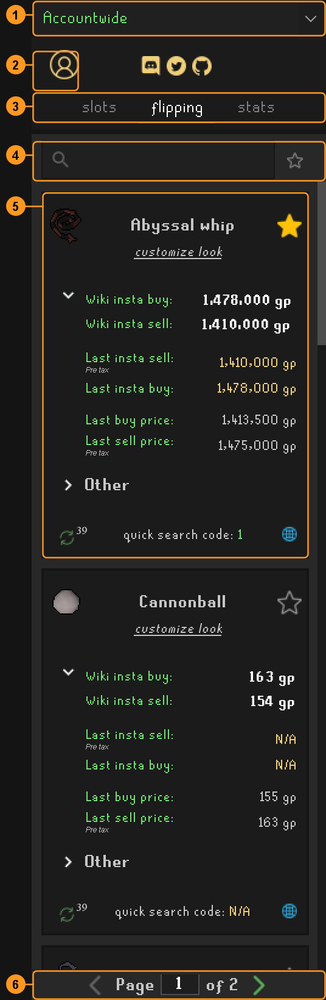

# Flipping Utilities user guide

Flipping Utilities is a RuneLite plugin for Grand Exchange traders. It records every offer you make, works out
your profit as you trade, shows live wiki prices next to your own, and helps you fill in prices and quantities
in the GE with a key press.

This guide covers version 1.4.1 of the plugin. The screenshots are rendered from the plugin's own panels with
example data (see [Maintaining this guide](maintaining.md)), so the numbers in them are illustrative.

## Contents

| Page | What it covers |
| --- | --- |
| [Getting started](#getting-started) | Install the plugin and find your way around the sidebar |
| [Flipping tab](flipping-tab.md) | Item cards, wiki prices, GE limits, favorites, customizing the cards |
| [Setting up offers](offer-setup.md) | Offer editor hotkeys, chat shortcuts, the offer page chart, quick search codes |
| [Slots](slots.md) | The slots tab, slot timers, colored slot borders and the quick look tooltip |
| [Statistics](statistics.md) | Profit over any time range, per-item history, flips, CSV export, resets |
| [Recipe flips](recipe-flips.md) | Track profit when you combine, split or decant items, and custom recipes |
| [Adding untracked trades](ge-history.md) | Import trades made on mobile or without the plugin from the GE history |
| [Linking to Flipping Utilities](account-linking.md) | The optional login, Discord notifications and what gets sent |
| [Settings](settings.md) | Every option in RuneLite's configuration panel |
| [Your data](your-data.md) | Multiple accounts, hardcore worlds, where trades are stored, backups, how profit is calculated |

## Getting started

### Install

1. In RuneLite, open the **Plugin Hub** (wrench icon in the sidebar, then **Plugin Hub**).
2. Search for **Flipping Utilities** and click **Install**.
3. Click the Flipping Utilities icon (a green graph) in the RuneLite sidebar to open the panel.

Then trade as usual. The plugin starts recording as soon as one of your offers fills.

> [!NOTE]
> Ironman accounts and seasonal worlds are not tracked. Hardcore-world trades are kept apart from your regular
> history (see [Your data](your-data.md#hardcore-and-deadman-worlds)).

### The sidebar

1. **Account selector.** Appears once more than one of your accounts has trades. **Accountwide** merges every
   account; pick a name to see only that account. Logging into an account selects it.
2. **Login button.** Opens the optional [Flipping Utilities login](account-linking.md). The links to the
   Discord, Twitter and GitHub pages are next to it.
3. **Tabs.** [slots](slots.md) shows your 8 GE slots, [flipping](flipping-tab.md) (the default) has a card per
   item you are trading, and [stats](statistics.md) has your trade history and profit.
4. **Search and favorites filter.** Search any item, even ones you never traded. The star shows only your
   favorites.
5. **Item card.** Your latest prices for the item next to the wiki's, sorted by most recent activity.
6. **Pages.** Ten cards per page.

A fourth view, **Grand Exchange History**, opens by itself when you open the History screen of the GE in game
(see [Adding untracked trades](ge-history.md)).

 

### A typical session

1. Open the GE and set up an offer. The flipping tab jumps to that item and shows the
   [offer editor](offer-setup.md): press a key to fill in the wiki price, your last price or your remaining
   GE limit.
2. While offers run, the [slots tab](slots.md) and the timers drawn on the GE slots show how long each offer
   has been waiting and whether its price is still competitive against the wiki.
3. When offers complete, the [stats tab](statistics.md) adds them to the item's history and pairs buys with
   sells into flips, after GE tax.

## Help

Ask on the [Flipping Utilities Discord](https://discord.gg/GDqVgMH26s) or open an issue on
[GitHub](https://github.com/Flipping-Utilities/rl-plugin/issues).
