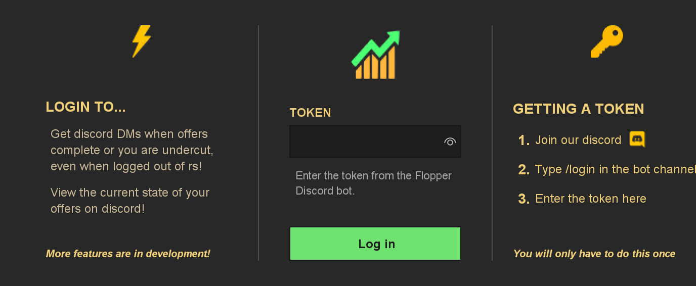
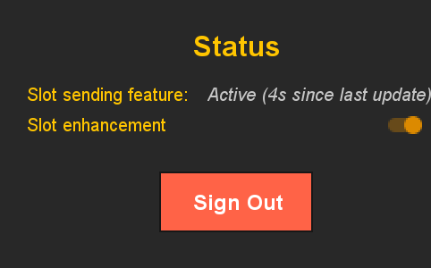

# Linking to Flipping Utilities

[User guide](README.md) › Linking to Flipping Utilities

Logging in is optional: everything else in this guide works without it. Linked, the plugin sends your live
GE slots to Flipping Utilities, so the Flopper Discord bot can message you when an offer completes or is
undercut, even when you are logged out of the game, and you can see your offers on Discord and on the
[Slots page](https://prices.osrs.cloud/slots) of prices.osrs.cloud.

## Logging in

1. Join the [Flipping Utilities Discord](https://discord.gg/GDqVgMH26s).
2. Type `/login` in the bot channel. The Flopper bot replies with a token.
3. Click the person icon at the top of the plugin panel, paste the token in **TOKEN** and click **Log in**.
4. Confirm the warning: logging in sends your GE transactions and your IP address to Flipping Utilities, a
   third party not controlled or verified by the RuneLite developers.

You only do this once: the plugin keeps the session and renews it. If it expires, log in again with a new
token. Each account you then log into in game is linked to your Flipping Utilities account automatically.

## Once logged in

The person icon turns into your profile icon, and clicking it shows your status:

- **Slot sending feature** says whether your slots are being sent: *Active (Ns since last update)*,
  *Active (no slot change detected)*, *Inactive (not logged in)*, *Inactive (not registered yet)* or
  *Inactive (error on slot update)*.
- **Slot enhancement** turns the [colored borders and magnifiers](slots.md#in-game-slot-borders-and-quick-look)
  on the GE slots on or off.
- **Sign Out** forgets the session; you'll need a new token from the bot to log in again.

If the session can't be checked, the window shows **Error logging in** with a **Retry** button.

 

## What is sent

Every 10 seconds, and only when something changed, the plugin sends your account name and, for each GE slot:
buy or sell, the item, the quantity and price of the offer, how many filled and for how much, the offer's state,
and when it was created and last traded. Your trade history stays on your computer.
