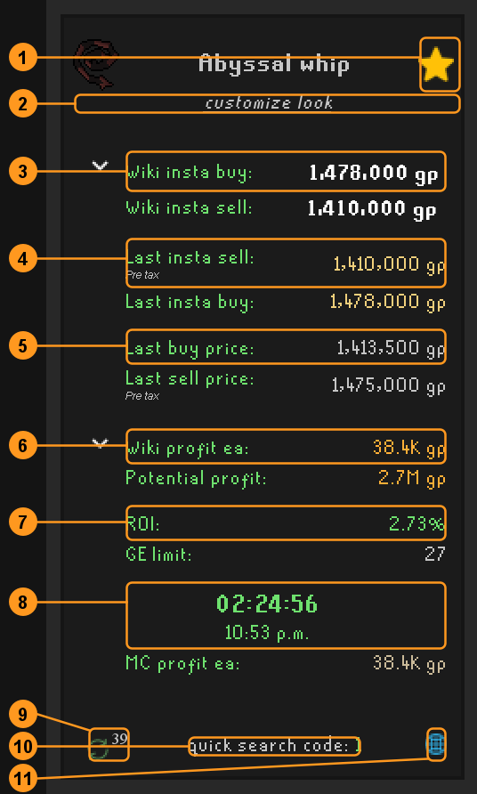
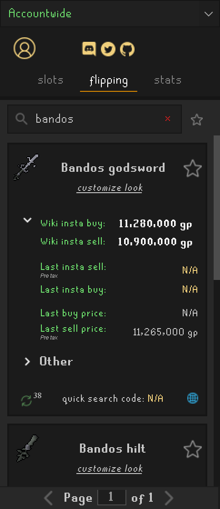
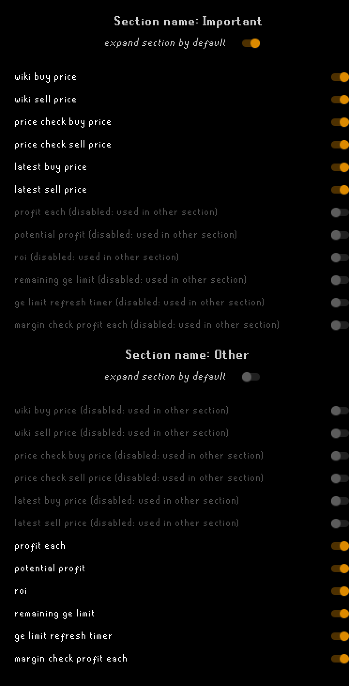

# Flipping tab

[User guide](README.md) › Flipping tab

The flipping tab has a card for every item you are trading, with the latest prices you got next to the
wiki's live prices. An item appears here once one of its offers fills, and cards are sorted by most recent
activity, ten per page.

## Item cards

1. **Favorite.** Star the items you trade often, then show only them with the star next to the search bar.
   Favorites also get a [quick search code](offer-setup.md#quick-search-codes). In the Accountwide view the star
   applies to every account that traded the item.
2. **customize look.** Choose which values the card shows (see [below](#customizing-the-cards)).
3. **Wiki prices.** The latest instant buy and instant sell prices from the
   [OSRS Wiki real-time prices](https://prices.runescape.wiki). Hover a price to see how old it is.
4. **Your last insta sell and insta buy.** The prices of your last *margin check*: an offer for a single item
   that completed within two game ticks of being placed. "Pre tax" means the GE tax is not deducted.
5. **Your last buy and sell price.** From your most recent offers, margin check or not. Click **Last buy
   price** or **Last insta buy** to type a different value; it is used until the next offer for the item and is
   not saved.
6. **Profit each.** **Wiki profit ea** is the wiki insta buy price after GE tax minus the wiki insta sell
   price; **Potential profit** multiplies it by the item's GE limit (or by what is left of it, see
   [Settings](settings.md)).
7. **ROI and GE limit.** ROI is the wiki profit relative to the wiki insta sell price; its color runs from red
   to green, and reaches bright green at the ROI set in [Settings](settings.md). **GE limit** is how many you can
   still buy in the current 4-hour window. If the item's limit is unknown it reads **Bought** instead, the number
   you bought in the window.
8. **GE limit reset.** A countdown to the end of the 4-hour buy limit window, and the local time it resets.
   It shows **Now** when no window is running.
9. **Next wiki refresh.** Seconds until the wiki prices are fetched again (every 60 seconds). Prices are only
   fetched while the sidebar is open or [slot enhancement](slots.md#in-game-slot-borders-and-quick-look) is on.
10. **Quick search code.** The code you can type in the GE search to list your favorites (see
    [Setting up offers](offer-setup.md#quick-search-codes)). Click it to change it; it reads N/A until the item is
    a favorite.
11. **Price page.** Opens the item on [prices.osrs.cloud](https://prices.osrs.cloud).

**MC profit ea** (margin check profit) uses your last insta buy and insta sell prices instead of the wiki's.

 

### Showing and hiding

- Click the item name to collapse or expand the whole card. Cards start expanded unless **toggle verbose view**
  is off in [Settings](settings.md). Your choice lasts until RuneLite restarts.
- Click a section's arrow to open or close it. **Other** starts closed.
- Hover the item icon and click the cross to remove the item from the tab. It comes back the next time you
  trade it. Its history stays in the stats tab.
- Hover a card to see which account traded it last ("Flipped by").

## Searching

Type in the search bar to filter the tab. The search uses RuneLite's item list, so it also finds items you
never traded: those get an empty card with the wiki prices, which is a quick way to check a margin before
buying. Starring one adds it to your favorites.

Clear the search with the red cross. While an item is highlighted because you are setting up a GE offer,
the search is ignored.

 

## Customizing the cards

**customize look** on any card opens a window that applies to every card.

Each card has two sections, **Important** and **Other**. For each section you choose:

- **expand section by default**, whether it starts open;
- which values it shows. A value can only be in one section; values used by the other section are grayed out.

The value names in this window are older names for the card labels:

| In the window | On the card |
| --- | --- |
| wiki buy price / wiki sell price | Wiki insta buy / Wiki insta sell |
| price check buy price | Last insta sell |
| price check sell price | Last insta buy |
| latest buy price / latest sell price | Last buy price / Last sell price |
| profit each | Wiki profit ea |
| margin check profit each | MC profit ea |
| potential profit, roi, remaining ge limit | Potential profit, ROI, GE limit |
| ge limit refresh timer | The GE limit reset countdown |

Sections can't be added, renamed or removed.

 
