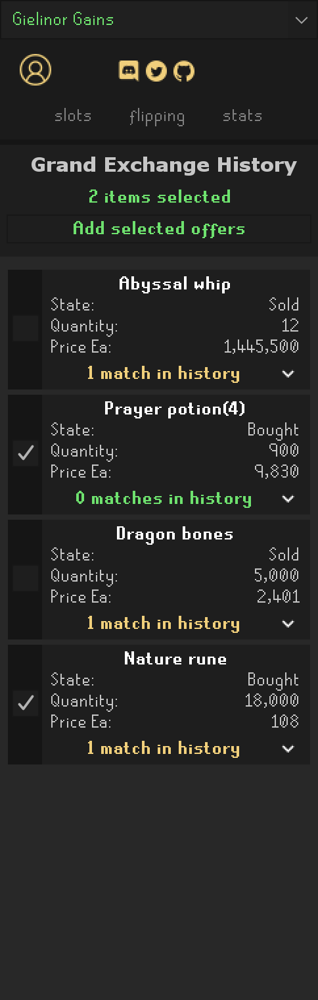
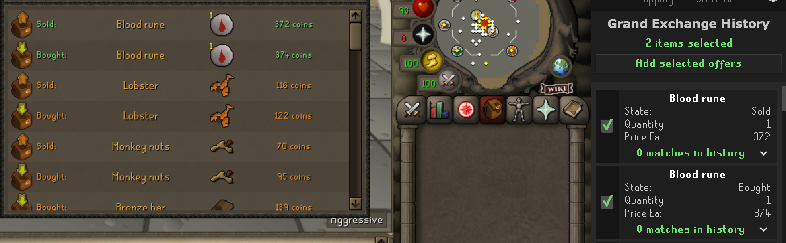

# Adding untracked trades

[User guide](README.md) › Adding untracked trades

Trades you made on mobile, or with the plugin off, aren't in your history. You can add them from the GE's
**History** screen.

1. Log into the account the trades belong to and open the GE **History** screen. The sidebar switches to
   **Grand Exchange History**, with a card for each trade in the game's list.
2. Each card says how many offers with the same item, quantity, price and buy/sell are already in your history.
   **0 matches in history** means the trade is not recorded yet. Expand the line to see when the matching
   offers were made.
3. Tick the trades to add. The matching rows are highlighted in the game's list.
4. Click **Add selected offers**. Added cards turn green.

The sidebar returns to the previous tab when you leave the History screen.

 

Good to know:

- The GE history doesn't say when a trade happened, so added offers are dated at the moment you add them, and
  count in the **Session** and **-1h** ranges of the [stats tab](statistics.md).
- Added offers don't count toward the GE limit timer, and are never treated as margin checks.
- Sell prices on the cards are after GE tax, like everywhere else in the plugin.

*In-game capture from an earlier version of the plugin.*
