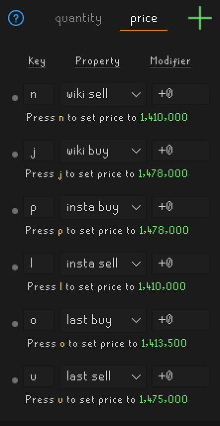
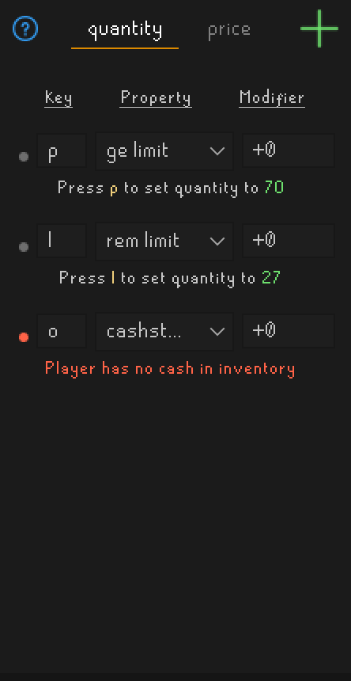
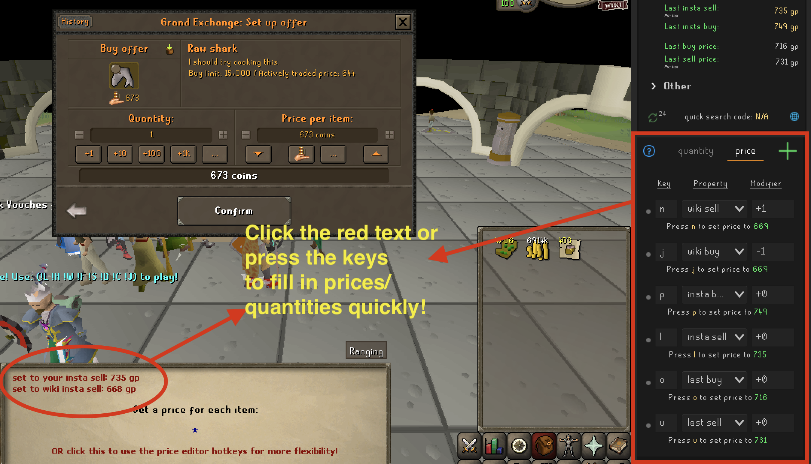
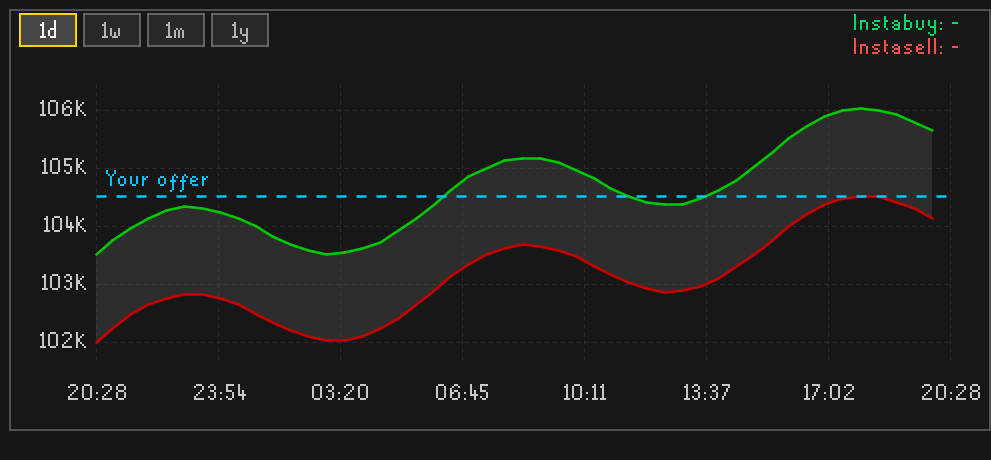
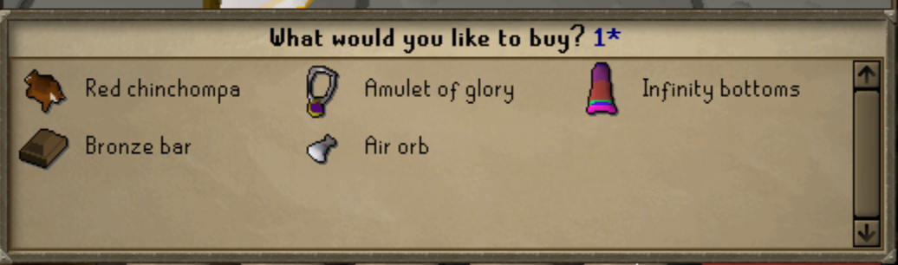

# Setting up offers

[User guide](README.md) › Setting up offers

When you open the GE's **Set up offer** screen, or click one of your existing offers, the flipping tab shows
only that item's card, with the offer editor below it. The plugin then helps you enter the price and quantity.

## Offer editor hotkeys

The offer editor has a list of *options*. Each option is a key, a property and a modifier. When the GE asks
for a price or a quantity, press an option's key and the plugin types the result into the prompt; press Enter
to confirm as usual.

- The **price** tab is used for **Set a price for each item:** and the **quantity** tab for **How many do you
  wish to buy?**. The plugin switches tabs by itself on those prompts; for the sell quantity prompt, select the
  quantity tab yourself.
- Under each option, "Press *key* to set price to *value*" previews the result for the highlighted item. A red
  message explains why an option can't be used right now, for example *wiki has no data for this item*.
- Click **+** to add an option. Hover the dot on the left of an option and click the cross to delete it.
- After editing a key or a modifier, press Enter to save it.
- **?** opens a short help.

Options are shared by all your accounts.

 

### Properties

| Property | Value |
| --- | --- |
| **wiki buy** / **wiki sell** | The wiki's latest insta buy / insta sell price |
| **insta buy** / **insta sell** | Your last margin check buy / sell price |
| **last buy** / **last sell** | Your last buy / sell price |
| **ge limit** | The item's GE buy limit |
| **rem limit** | What's left of the GE limit in the current 4-hour window |
| **cashstack** | How many you can buy with the coins in your inventory, at the price in the offer |

Sell prices are before tax, as you would type them in the GE.

### Modifiers

A modifier is `+`, `-` or `*` followed by a number: `+0` uses the value as is, `-1` undercuts by one coin,
`+10` adds 10, `*0.5` halves it (results are rounded). Results can't be negative or above the GE's maximum.

### Default options

| Key | Price | Quantity |
| --- | --- | --- |
| `n` | wiki sell | |
| `j` | wiki buy | |
| `p` | insta buy | ge limit |
| `l` | insta sell | rem limit |
| `o` | last buy | cashstack |
| `u` | last sell | |

If you deleted every option, a button under the list adds the defaults back.

 

## Chat shortcuts

The GE's price and quantity prompts also get clickable lines in the chatbox:

- quantity prompt: **set to remaining GE limit**;
- buy price prompt: **set to your insta sell** and **set to wiki insta sell**;
- sell price prompt: **set to your insta buy** and **set to wiki insta buy**;
- **OR click this to use the price editor hotkeys for more flexibility!** opens a picture of the offer editor.

*In-game capture from an earlier version of the plugin.*

## Offer page chart

On the **Set up offer** and **Offer status** screens, a chart of the item's wiki price history covers the
chatbox: green is the insta buy price, red the insta sell price, and the dashed line your offer's price.

- **1d**, **1w**, **1m** and **1y** change the range. The default range is the **Time range** in
  [Settings](settings.md); a change there is used after RuneLite restarts.
- Hover the chart to read the prices at that time in the top right corner.
- While setting up an offer, click a point to pick its price. The **Enter price** button is highlighted, and the
  next price prompt is filled with that price.
- If the prices can't be loaded, click **Retry**.

The chart hides while a number prompt or the item search is open. Turn it off with **Offer page charts** in
[Settings](settings.md).

## Quick search codes

Every favorite item has a quick search code, `1` by default. Type a code in the GE item search to list all
your favorites that have that code, then pick one. Use different codes to make groups, for example `1` for
items you buy every day and `2` for slow overnight flips.

*In-game capture from an earlier version of the plugin.*

To change an item's code, click **quick search code** at the bottom of its card in the
[flipping tab](flipping-tab.md), type the code and press Enter. Only favorites of the account you are logged
into are listed.
