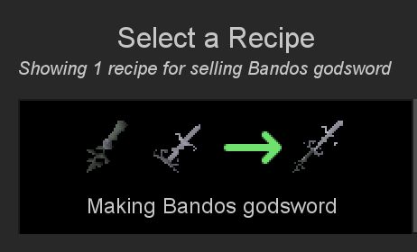
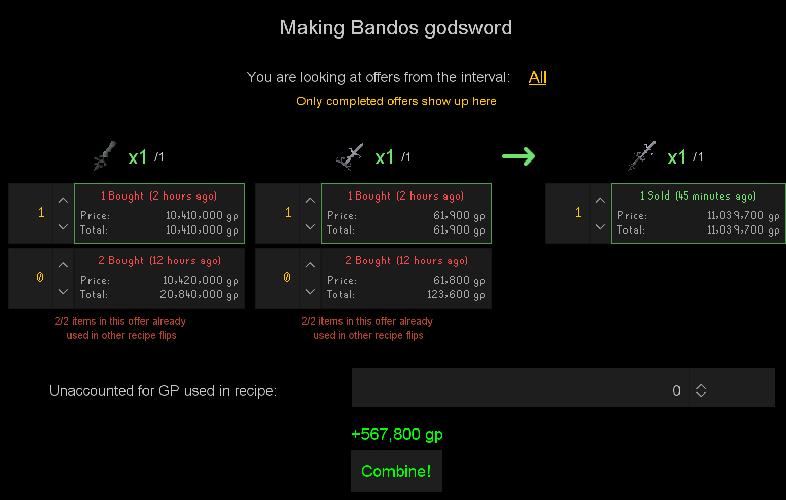
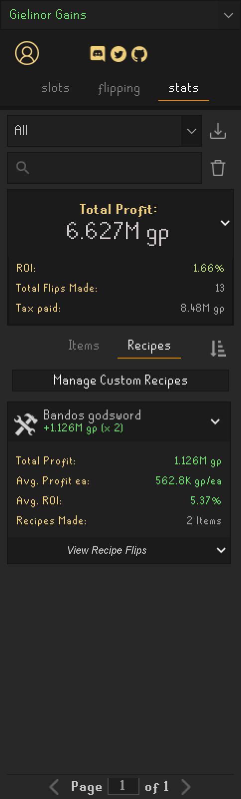
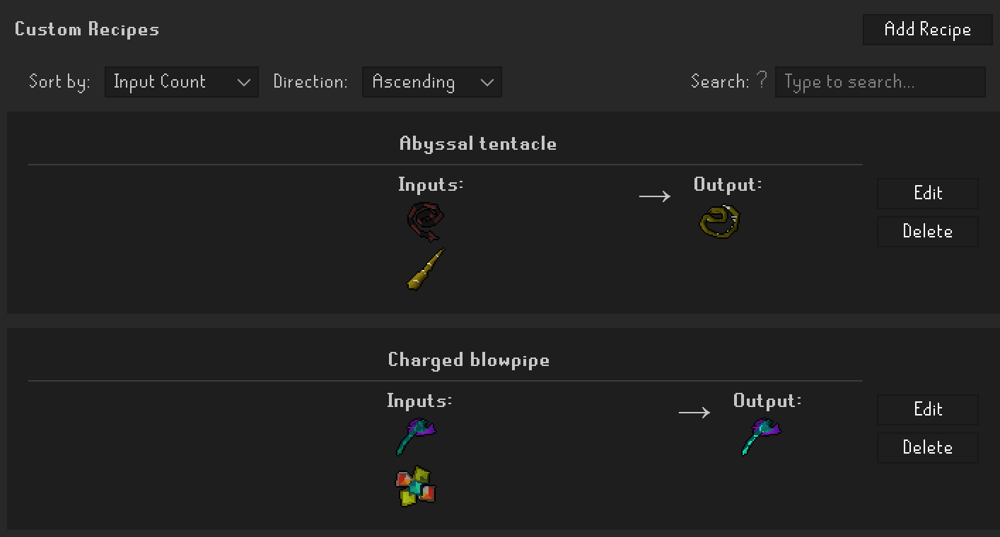

# Recipe flips

[User guide](README.md) › Recipe flips

Some flips don't sell the item you bought: you buy a Godsword blade and a Bandos hilt and sell the Bandos
godsword, or buy 3-dose potions and sell them decanted to 4-dose. A *recipe flip* records which offers went
into the result, so the profit is counted once, on the recipe, instead of as a loss on the parts and a gain
on the product.

The plugin knows the recipes in the
[Flipping Utilities datasets](https://github.com/Flipping-Utilities/osrs-datasets) (item combinations and
potion decanting), plus your own [custom recipes](#custom-recipes).

## Recording a recipe flip

Recipe flips belong to one account: select it in the account selector first (not Accountwide).

1. In the [stats tab](statistics.md), expand the item you sold (or bought), open **View Trade History** and
   find the offer.
2. Click **Recipe Flip +** on the offer. The button only appears on completed offers of items that are part of
   a recipe.
3. Pick the recipe:

   

4. Choose how many items of each offer went into the recipe. The pickers start at the amounts that make the
   most complete recipes; offers already used by other recipe flips are marked. Only completed offers from the
   stats tab's time range are listed.

   

5. If the recipe cost something that isn't an offer (coins for a fee, for example), enter it in
   **Unaccounted for GP used in recipe**. The profit updates as you go.
6. Click **Combine!** It is enabled once every item has the amount the recipe needs.

## The Recipes tab

Recipe flips are grouped by recipe in the **Recipes** sub-tab of the stats tab, with their total profit,
average profit each, average ROI and the number made. **View Recipe Flips** lists each one with its inputs and
outputs. The offers used by a recipe flip no longer count in their items' own statistics.

 

## Custom recipes

**Manage Custom Recipes**, at the top of the Recipes tab, opens a window to add recipes the datasets don't have.

- **Add Recipe**: give it a name, then search items for the **Inputs** and **Outputs** (type at least two
  letters) with their quantities, and **Save**.
- **Edit** and **Delete** change or remove a recipe.
- **Sort by** and **Direction** order the list; the defaults are in [Settings](settings.md#custom-recipes),
  with the options to include noted and untradeable items in the item search.

Custom recipes are shared by all your accounts and are available right away in **Recipe Flip +**.
