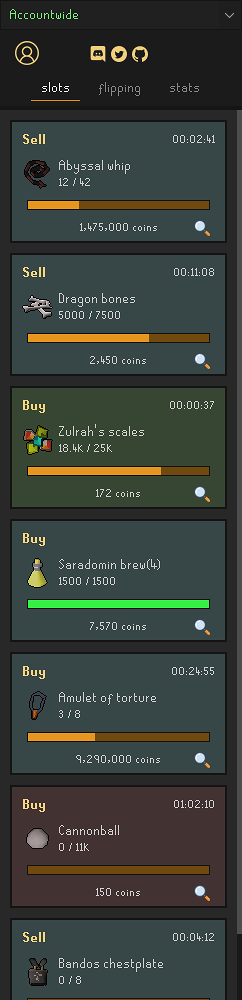
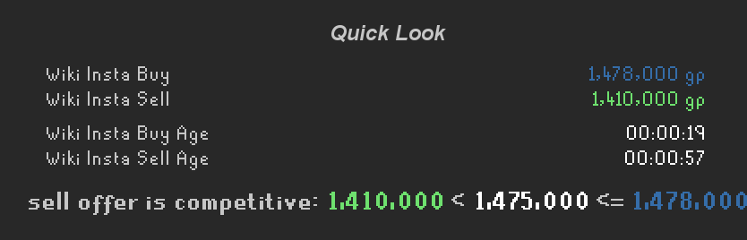
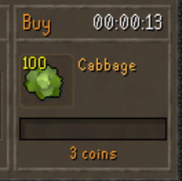
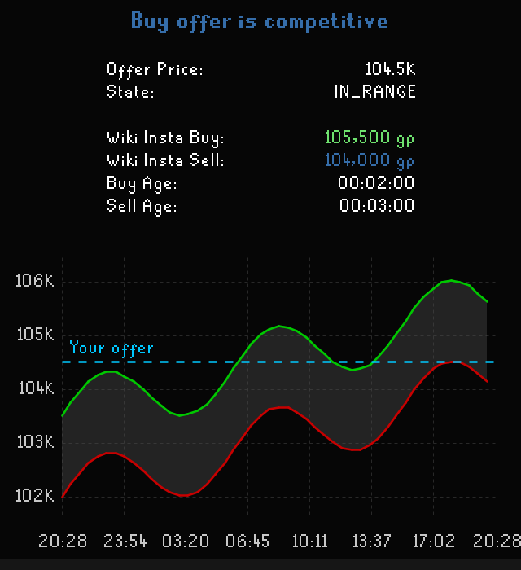

# Slots

[User guide](README.md) › Slots

The plugin follows your 8 Grand Exchange slots in the **slots** tab of the sidebar and on the GE interface
itself.

## Slots tab

Each active offer gets a card with:

- **Buy** or **Sell**, and how long since the offer last traded;
- the item, and how many have filled out of the offer's quantity;
- a progress bar: orange while running, green once complete, red when cancelled;
- the offer's price, and a magnifier that opens the [quick look](#quick-look) when hovered.

The card's background compares your price with the wiki's latest prices:

| Background | Meaning |
| --- | --- |
| Green | Better than the wiki: a buy above both wiki prices, or a sell below both. It should fill quickly. |
| Gray-teal | In range: the price is between the wiki's insta sell and insta buy prices. |
| Red | Out of range: a buy below both wiki prices, or a sell above both. It may not fill until the price moves. |

In the screenshot, the Zulrah's scales buy at 172 is above the wiki's 171 insta buy price (green), and the
cannonball buy at 150 is below the wiki's 154 insta sell price (red).

When no offer is active, the tab says **No currently active slots**.

 

## Quick look

Hover the magnifier of a slot card to compare the offer with the wiki prices, how old those prices are, and
what the offer needs to be competitive.

## In-game slot timers

The plugin replaces the **Buy** / **Sell** title of each GE slot with a timer:

- while the offer runs, the time since it last traded (or since it was placed);
- once it completes or is cancelled, how long the whole offer took, in green.

The timer turns red when an offer hasn't traded for longer than the **Set trade stagnation time** (15 minutes by
default), a hint to change your price. Offers that filled while you were logged out show no timer, because the
plugin doesn't know when they traded.

Turn the timers off, change the stagnation time or the colors of the Buy/Sell text in [Settings](settings.md).

*In-game capture from an earlier version of the plugin.*

 

## In-game slot borders and quick look

With **slot enhancement** on (it is by default), each GE slot gets:

- a colored border with the same meaning as the slots tab: **green** better than the wiki, **blue** in range,
  **red** out of range. Turn the borders off with **toggle colored slot borders** in [Settings](settings.md).
- a magnifier. Hover it for the quick look tooltip, with a price chart of the item over the **Time range** set in
  [Settings](settings.md). If the chart can't load, click the magnifier to retry. **Quick lookup** in
  [Settings](settings.md) turns the magnifier off.

The **Slot enhancement** switch itself is in the status window of the
[Flipping Utilities login](account-linking.md#once-logged-in).
