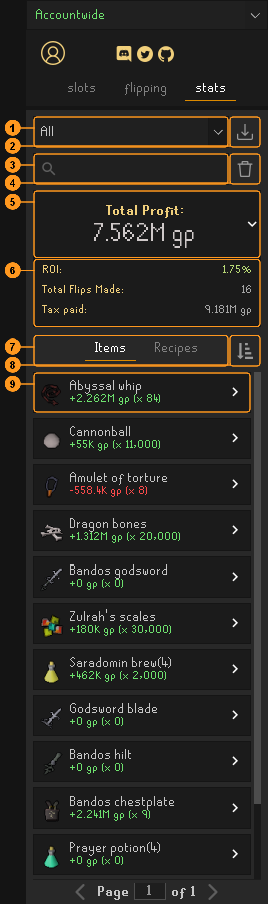
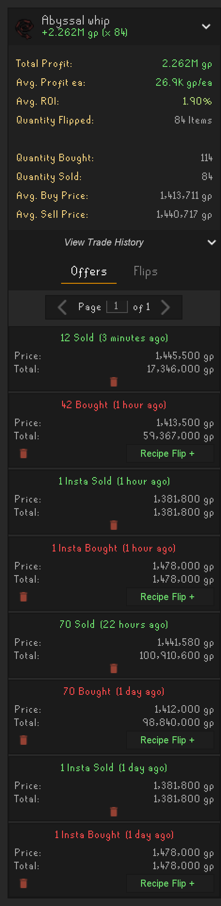
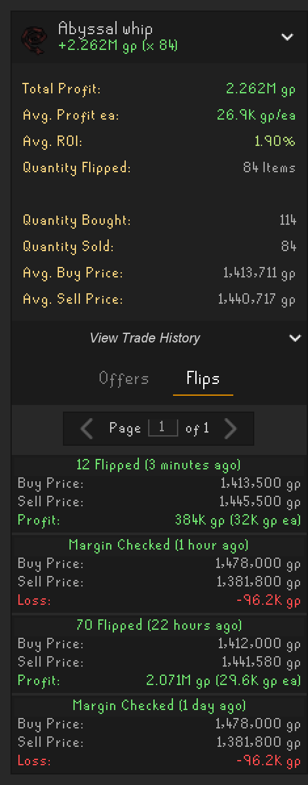

# Statistics

[User guide](README.md) › Statistics

The **stats** tab keeps every offer you made, pairs buys with sells into flips, and adds up your profit after
GE tax over any time range.

## Overview

1. **Time range.** **Session** (the default), **-1h**, **-4h**, **-12h**, **-1d**, **-1w**, **-1m** or **All**.
   You can also type your own range, a minus sign, a whole number and a unit: `-6h`, `-3d`, `-2w`, `-6m` or
   `-1y` (a month is 30 days).
2. **Export to CSV.** Saves the trades of the time range to a CSV file (see [below](#csv-export)).
3. **Search.** Filters items and recipe flips by name.
4. **Reset.** Deletes the offers of the selected time range, after asking. In the Accountwide view this deletes
   them from every account.
5. **Total profit.** Red when negative. Click it to show or hide the details.
6. **Details.** **ROI**, **Total Flips Made** and **Tax paid**. In the Session range you also get
   **Session Time** and **Hourly Profit**, and **Next auto-save** when [auto-save](settings.md#auto-save) is on.
7. **Items and Recipes.** Your items, or your [recipe flips](recipe-flips.md).
8. **Sort.** By time (the default), total profit, profit each, ROI or flip count, highest first.
9. **Item.** Its profit and how many were flipped in the time range. Click to expand it.

Session time only counts while you are logged in and have at least one offer running, so hourly profit
reflects the time you spent trading.

 

## An item's history

An expanded item shows its totals for the time range: profit, average profit each, average ROI, quantity
flipped, bought and sold, and average buy and sell prices. **View Trade History** opens two lists, ten per
page:

- **Offers**: every offer, with its price and total. Sell prices here are after tax. An offer that is still
  running says *(ongoing)*; margin checks show as **Insta Bought** / **Insta Sold**.
- **Flips**: buys matched with the sells that followed. Each flip shows the buy price, the sell price after
  tax and the profit or loss. A margin check bought and sold within a minute shows as **Margin Checked**.

To delete one offer, hover it and click the trash icon. To delete all of an item's offers in the time range,
hover the item icon and click the cross. Deleting is only possible when viewing a single account, not
Accountwide.

 

## CSV export

The export button asks for a folder and writes `<account>.csv` (or `Accountwide.csv`) with one line per offer:
`name,date,quantity,price,state`, sell prices after tax, and the item's total profit after its offers. You
can't save into the plugin's own data folder.

## Empty states

- **No trade history yet**: complete a GE offer and it shows up here.
- **No results in this interval**: you have trades, just not in the selected time range. **Show all time**
  switches to All.
- **No matching trades**: nothing matches the search. **Clear search** empties it.
